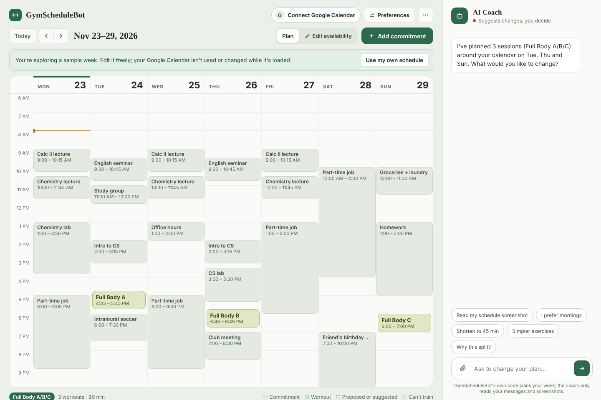
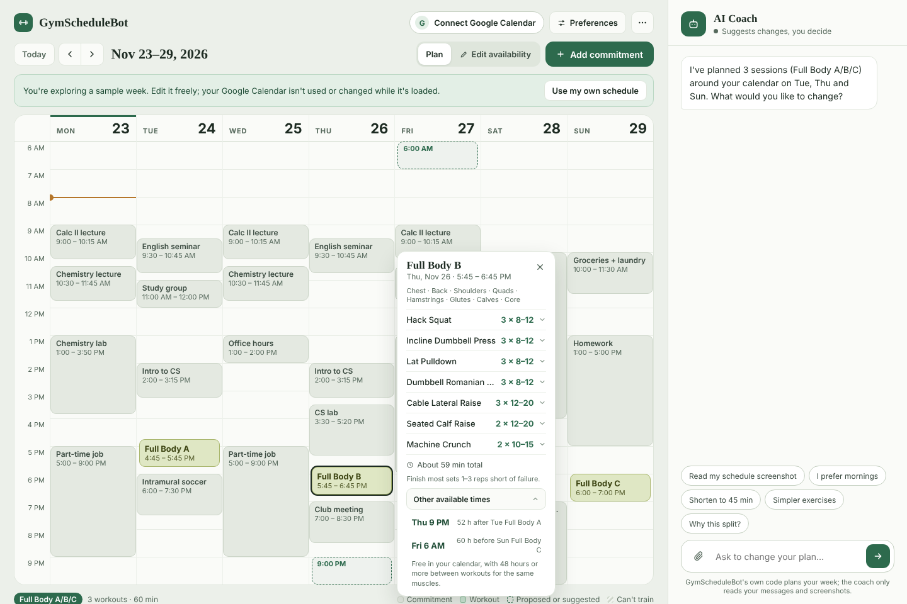

# GymScheduleBot 3.0

**Workout plans that fit around your actual week.**

### [Try it live → gymschedulebot-3-0.onrender.com](https://gymschedulebot-3-0.onrender.com/)

No sign-up needed: load a sample week and explore. (It's on free hosting, so the first visit can take up to a minute to wake up.)

## Overview

Most workout plans assume a free, predictable week. Real weeks have classes, shifts and plans that change, and a fixed routine quickly stops fitting.

GymScheduleBot starts from your schedule instead. It looks at when you're free, how often you want to train and how long your workouts can be, then recommends what to train and when, leaving enough recovery time between workouts for the same muscles. If your week changes, you drag a workout or tell the AI Coach, and the plan adjusts.

Version 3.0 is a rebuild of [GymScheduleBot 2.0](https://github.com/kaiwakura/GymSchedule-Bot-2.0) with a calendar-first interface, an AI Coach that proposes changes before applying them, and Google Calendar sync.

## Features

- **Personalized muscle-building plans:** a full week of workouts with exercises, sets and reps, built around your free time and preferences.
- **Splits that match your week:** full-body, upper/lower or push/pull/legs, chosen by how many days you can train.
- **Recovery-aware scheduling:** workouts that train the same muscles are spaced at least 48 hours apart, including across weeks.
- **AI Coach:** ask in plain English ("I have soccer Tuesdays 6–7:30", "move Thursday's workout to Friday morning", "no barbell rows") or send a screenshot of your timetable. Changes that move workouts are shown as a preview to accept or reject.
- **Google Calendar integration:** plan around your real busy times and sync workouts to a dedicated GymScheduleBot calendar, with a preview before anything changes.
- **Interactive calendar:** browse any week, drag workouts to new times, see other times that fit, and mark time you can't train.
- **Customizable preferences:** training frequency, workout length, preferred time of day, travel time to the gym, and the split itself.
- **Workout details:** each workout lists its exercises, sets, reps, rest times and the muscles it trains.

## Screenshots

| Weekly plan | Workout details |
|---|---|
|  |  |

## How It Works

### Scheduling

1. **Find free time.** Busy blocks come from Google Calendar, your own commitments or a sample week. Each gets a travel buffer, and the gaps long enough for a workout become options.
2. **Choose a split.** The number of workouts is the smaller of your commitment level (1–5 a week) and the days you have free. More free time never means more workouts than you chose.

   | Workouts per week | Split | Each major muscle trained |
   |---|---|---|
   | 1 | Full Body | 1× |
   | 2 | Full Body A + B | 2× |
   | 3 | Full Body A + B + C | 3× |
   | 4 | Upper / Lower / Upper / Lower | 2× |
   | 5 | Push / Pull / Legs + Upper / Lower | 2× |

3. **Build each workout** to fit your workout length, counting warm-up, sets and rest.
4. **Place the workouts.** The scheduler checks every combination of days and start times. It rejects any that put two workouts for the same muscles less than 48 hours apart, and picks the one with the best recovery spacing closest to your preferred time. If nothing fits, it falls back to another split and explains why.

### AI Coach

The coach uses Google Gemini to understand messages, but it doesn't make scheduling decisions. Gemini turns each message into a structured list of requested changes (checked against a fixed format), and the scheduling code decides what actually happens. Facts like a new weekly commitment apply right away. Changes that would move workouts appear on the calendar as a proposal first. Without a Gemini key, a simpler keyword-based parser handles common requests, so the app works without AI.

### The exercise science

The default plan follows principles from recent research reviews, used as sensible starting points rather than strict rules:

- **Weekly volume matters most.** Muscle growth increases with weekly sets per muscle, with diminishing returns. About 10 or more sets per muscle per week is a common target [1, 2]. Following [1], sets for muscles that only assist in an exercise count as half a set.
- **How often matters less than how much.** At the same weekly volume, training a muscle more often or using a split instead of full-body workouts makes little difference [1, 3]. Training each muscle twice a week is the app's choice for keeping workouts a manageable length, not a research finding.
- **Recovery between workouts.** At least 48 hours between workouts for the same muscle, preferring 72, is a conservative rule of thumb; recovery varies from person to person.
- **Effort and rest.** Training close to failure was associated with more growth [4], so sets stop 1–3 reps short of it. Rest periods longer than a minute showed a small benefit [5]; the app uses 2–3 minutes after big compound lifts and 1–2 after smaller exercises.

The coach can adjust exercise choice, sets and rep ranges, but the app never guesses your experience level.

<details>
<summary>References</summary>

1. Pelland JC, et al. The Resistance Training Dose Response: Meta-Regressions Exploring the Effects of Weekly Volume and Frequency on Muscle Hypertrophy and Strength Gains. *Sports Medicine*, 2026. [doi:10.1007/s40279-025-02344-w](https://doi.org/10.1007/s40279-025-02344-w)
2. Currier BS, et al. ACSM Position Stand: Resistance Training Prescription for Muscle Function, Hypertrophy, and Physical Performance in Healthy Adults. *Medicine & Science in Sports & Exercise*, 2026. [doi:10.1249/MSS.0000000000003897](https://doi.org/10.1249/MSS.0000000000003897)
3. Ramos-Campo DJ, et al. Efficacy of Split Versus Full-Body Resistance Training on Strength and Muscle Growth. *Journal of Strength and Conditioning Research*, 2024. [doi:10.1519/JSC.0000000000004774](https://doi.org/10.1519/JSC.0000000000004774)
4. Robinson ZP, et al. Exploring the Dose–Response Relationship Between Estimated Resistance Training Proximity to Failure, Strength Gain, and Muscle Hypertrophy. *Sports Medicine*, 2024. [doi:10.1007/s40279-024-02069-2](https://doi.org/10.1007/s40279-024-02069-2)
5. Singer A, et al. Give it a rest: a systematic review with Bayesian meta-analysis on the effect of inter-set rest interval duration on muscle hypertrophy. *Frontiers in Sports and Active Living*, 2024. [doi:10.3389/fspor.2024.1429789](https://doi.org/10.3389/fspor.2024.1429789)

</details>

## Tech Stack

- **Backend:** Python 3.11+, FastAPI, Jinja2
- **Frontend:** HTML, CSS and vanilla JavaScript (no build step)
- **APIs:** Google Calendar API (OAuth 2.0 with PKCE), Google Gemini API (structured JSON output)
- **Testing and tooling:** pytest, Ruff, GitHub Actions
- **Hosting:** Render

## Getting Started

```bash
git clone https://github.com/kaiwakura/GymScheduleBot-3.0.git
cd GymScheduleBot-3.0
python -m venv .venv && source .venv/bin/activate   # Windows: .venv\Scripts\activate
pip install -r requirements-dev.txt
cp .env.example .env
uvicorn app.main:app --reload
```

Open http://localhost:8000. The app works with no keys at all: the sample weeks, your own commitments and the keyword-based coach all run offline.

Run the tests and linter:

```bash
pytest -q
ruff check . && ruff format --check .
```

**Optional: the AI Coach.** Add a free Gemini key from [Google AI Studio](https://aistudio.google.com/apikey) to `.env` as `GEMINI_API_KEY`.

**Optional: Google Calendar.** You need your own OAuth client in Google Cloud:
1. Create a project and enable the **Google Calendar API**.
2. In **Google Auth Platform**, set the audience to External, add yourself as a test user, and add these scopes:
   ```
   https://www.googleapis.com/auth/calendar.events.freebusy
   https://www.googleapis.com/auth/calendar.calendarlist.readonly
   https://www.googleapis.com/auth/calendar.app.created
   ```
3. Create a **Web application** client with the redirect URI `http://localhost:8000/auth/google/callback`.
4. Fill in `GOOGLE_CLIENT_ID`, `GOOGLE_CLIENT_SECRET`, `SESSION_SECRET` and `TOKEN_ENCRYPTION_KEY` in `.env` (it explains each one). Generate the last two with:
   ```bash
   python -c "import secrets; print(secrets.token_hex(32))"
   python -c "from cryptography.fernet import Fernet; print(Fernet.generate_key().decode())"
   ```

## Technical Design

**AI translates, code decides.** The language model only converts messages into structured changes, validated against a JSON schema. Splits, exercises, times and recovery are decided by deterministic, unit-tested Python, and the facts in the coach's replies come from that code too. Plans stay predictable and testable, API costs stay small, and the app still works if Gemini is unavailable.

**A deterministic scheduler.** A week has few enough options (at most a few thousand placements) that the scheduler can check them all instead of guessing. The 48-hour recovery rule is a hard constraint; spacing, recovery beyond 48 hours and preferred times are scored. Workouts you moved stay fixed, and recovery carries across week boundaries.

**Careful Google integration.**
- **Minimal access:** the app reads only when your calendars are busy, never event details, and can only change the calendar it creates.
- **No duplicates:** each workout gets a predictable event ID, so syncing twice, or after a reconnect, updates events instead of duplicating them.
- **No surprises:** a preview shows exactly what will change, and edits you make in Google Calendar are respected.

**Security.**
- Google tokens are encrypted and kept in a signed, HttpOnly session cookie.
- Requests that change data require a CSRF token.
- The Gemini key never leaves the server, and AI usage is rate-limited per visitor and site-wide.

**No database, on purpose.** Settings live in a signed cookie, and your own commitments and recent workouts in browser storage. That keeps a portfolio-scale app simple to run; a multi-user product would move this to a database.

**Tests.** Over 200 pytest tests cover scheduling, recovery, workout building, the AI Coach's parsing, security limits, and Google sync against a fake Google API. GitHub Actions runs them and Ruff on Python 3.11–3.13.

```
app/
  main.py            web routes
  planning.py        plans any week, using the weeks before it for recovery
  scheduler/         free time, splits, workouts, weekly volume, placement
  ai/                Gemini coach and the keyword fallback
  google_auth.py     Google sign-in and encrypted tokens
  calendar_sync.py   sync preview and applying changes
  templates/, static/
tests/
```

## Limitations

- **Google Calendar is limited to approved test users** while the app is in Google's testing mode. Anyone can still explore the app with the sample weeks or their own commitments.
- **Data stays in your browser.** Commitments, moved workouts and recent history are saved locally, so they don't follow you to another device.
- **The AI Coach needs Gemini for full understanding.** Without it, or past the usage limits, a simpler keyword parser handles common requests, and timetable screenshots can't be read.
- **Not professional advice.** The plans are general starting points informed by research, not a substitute for advice from a medical professional or qualified coach.

## License

[MIT](LICENSE)
